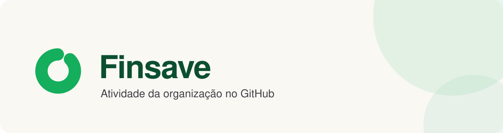
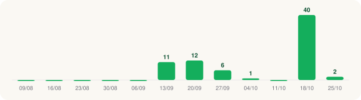

<picture>
  <source media="(prefers-color-scheme: dark)" srcset="./assets/banner-dark.svg">
  
</picture>

  
  
  
  

## 📈 Commits por semana

## 🧰 Linguagens

**Java** · **TypeScript** · **HTML**

---

 Finsave · <a href="https://finsave.site">finsave.site</a> · atualizado em 31/10/2026
